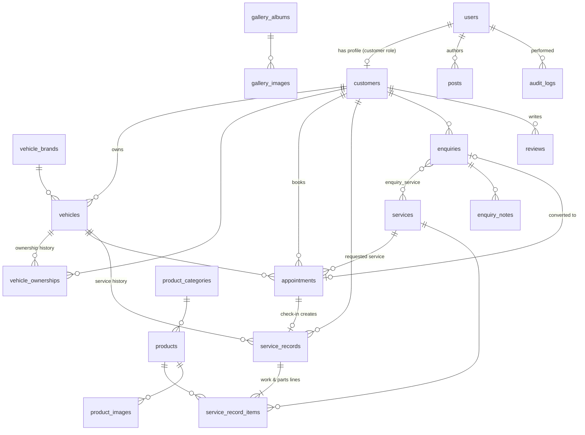

# Jayma Motors — Step 4: Database Schema & Relationships (DRAFT)

| Item | Value |
|---|---|
| Status | **Approved 2026-11-01** (S1–S4 as proposed) |
| Based on | Steps 1–3 (approved) |
| Engine | MariaDB (Hostinger), InnoDB, `utf8mb4` / `utf8mb4_unicode_ci` |
| Scope | Phase 1 tables, columns, relationships, indexes, constraints, seed data. Migrations are written in Step 8. |

---

## 1. Conventions

| Topic | Convention |
|---|---|
| Table names | `snake_case`, plural (`service_records`) |
| Primary key | `id` — `BIGINT UNSIGNED AUTO_INCREMENT` |
| Foreign key | `<singular>_id` (e.g. `customer_id`), always a real FK constraint |
| Timestamps | `created_at`, `updated_at` (UTC) on every business table |
| Soft delete | `deleted_at` only where listed below |
| Status / type columns | `VARCHAR(20)` holding a value from a PHP backed enum (no MySQL `ENUM` type — easier to change) |
| Money | `DECIMAL(12,2)` — never float |
| Booleans | `TINYINT(1)` (`boolean` in Laravel) |
| Text | `VARCHAR(n)` for short values, `TEXT` for notes, `LONGTEXT` for rich content |
| JSON | `JSON` (stored as validated LONGTEXT in MariaDB) — only for flexible lists, never for data that is searched or joined |
| Images | Stored as relative file paths (`VARCHAR(255)`) + alt text column |
| FK delete rule | `RESTRICT` by default (business records must not disappear); `CASCADE` only for child rows that have no meaning alone (e.g. line items); `SET NULL` for optional links |

Column types in the tables below: `bigint` = BIGINT UNSIGNED, `str(n)` = VARCHAR(n), `dec` = DECIMAL(12,2), `bool` = TINYINT(1), `ts` = TIMESTAMP.

---

## 2. Table Overview

| Group | Tables |
|---|---|
| Laravel framework | `users`, `password_reset_tokens`, `sessions`, `cache`, `cache_locks`, `jobs`, `job_batches`, `failed_jobs` |
| Sanctum | `personal_access_tokens` (installed, unused by website — reserved for a future mobile app) |
| Spatie Permission | `roles`, `permissions`, `model_has_roles`, `model_has_permissions`, `role_has_permissions` |
| Customers & vehicles | `customers`, `vehicle_brands`, `vehicles`, `vehicle_ownerships` |
| Services | `services` |
| Appointments | `appointments` |
| Enquiries | `enquiries`, `enquiry_service`, `enquiry_notes` |
| Service records | `service_records`, `service_record_items` |
| Reviews | `reviews` |
| Content | `posts`, `gallery_albums`, `gallery_images`, `product_categories`, `products`, `product_images`, `client_logos`, `pages`, `slug_redirects` |
| Settings | `settings`, `holidays` |
| System | `audit_logs`, `reference_counters` |

**39 tables** in total (14 framework/package, 25 business).

---

## 3. Entity Relationship Diagram (core business tables)



Plain-text summary of the key chain:

```
users (login) ─1:0..1─ customers ─1:N─ vehicles ─1:N─ service_records ─1:N─ service_record_items
                           │              │                 ▲
                           └─1:N─ appointments ─(check-in)──┘
```

---

## 4. Users, Roles & Customers

### 4.1 `users` — everyone who can log in (customers and staff)

| Column | Type | Rules |
|---|---|---|
| id | bigint PK | |
| name | str(100) | required |
| email | str(191) | required, **unique**, lower-case |
| phone | str(20) | nullable, **unique** (required for customers, optional for staff), normalised `+8801XXXXXXXXX` |
| email_verified_at | ts | nullable |
| password | str(255) | hashed |
| status | str(20) | `active` / `inactive`, default `active` |
| last_login_at | ts | nullable |
| remember_token | str(100) | nullable |
| created_at, updated_at | ts | |

- Customer vs staff is decided by **Spatie role** (`customer`, `service-advisor`, `manager`, `super-admin`), not by a column.
- No soft delete: accounts are deactivated (`status = inactive`) so history and audit links stay valid.
- Indexes: unique(`email`), unique(`phone`), index(`status`).

### 4.2 `customers` — customer profile (online or walk-in)

| Column | Type | Rules |
|---|---|---|
| id | bigint PK | |
| user_id | bigint FK → users | nullable, **unique** (one profile per login); `SET NULL` on delete |
| name | str(100) | required |
| phone | str(20) | required, normalised; **not unique** (an unverified online sign-up may share a walk-in's phone until staff link them — Step 3 §4.4) |
| email | str(191) | nullable |
| address | str(255) | nullable |
| notes | text | nullable, staff only |
| linked_at | ts | nullable — when a walk-in record was linked to a user account |
| created_by | bigint FK → users | nullable (staff who created a walk-in), `SET NULL` |
| created_at, updated_at, deleted_at | ts | soft delete |

- Indexes: unique(`user_id`), index(`phone`), index(`email`), index(`name`).
- Online sign-up: `users` row + `customers` row with `user_id`.
- Walk-in: `customers` row with `user_id = NULL`.

### 4.3 Spatie tables

Standard package tables (`roles`, `permissions`, `model_has_roles`, `model_has_permissions`, `role_has_permissions`). Only the `web` guard is used.

---

## 5. Vehicles

### 5.1 `vehicle_brands` — lookup for dropdowns

| Column | Type | Rules |
|---|---|---|
| id | bigint PK | |
| name | str(60) | **unique** |
| slug | str(80) | **unique** |
| is_active | bool | default true |
| sort_order | smallint | default 0 |
| created_at, updated_at | ts | |

### 5.2 `vehicles`

| Column | Type | Rules |
|---|---|---|
| id | bigint PK | |
| customer_id | bigint FK → customers | required, `RESTRICT` (current owner) |
| vehicle_brand_id | bigint FK → vehicle_brands | nullable, `SET NULL` |
| brand_name | str(60) | required — copy of brand name, or free text when brand is "Other" |
| model | str(80) | required |
| year | smallint unsigned | nullable, 1950 – current year + 1 |
| registration_number | str(40) | required, as entered (e.g. "Dhaka Metro Ga 12-3456") |
| registration_number_normalized | str(40) | required, **unique** (upper-case, no spaces/dashes) |
| chassis_number | str(40) | nullable, unique when present |
| color | str(30) | nullable |
| fuel_type | str(20) | nullable: `petrol`, `octane`, `diesel`, `cng`, `hybrid`, `electric`, `other` |
| archived_at | ts | nullable — hidden from customer (vehicle with history removed by customer) |
| created_at, updated_at | ts | |

- No soft delete — archiving keeps the unique registration number valid.
- Indexes: unique(`registration_number_normalized`), unique(`chassis_number`), index(`customer_id`, `archived_at`).

### 5.3 `vehicle_ownerships` — ownership history (Step 3 §5, C3)

| Column | Type | Rules |
|---|---|---|
| id | bigint PK | |
| vehicle_id | bigint FK → vehicles | `CASCADE` |
| customer_id | bigint FK → customers | `RESTRICT` |
| started_at | ts | required |
| ended_at | ts | nullable (NULL = current owner) |
| transferred_by | bigint FK → users | nullable, `SET NULL` |
| created_at, updated_at | ts | |

- A row is created when a vehicle is first added; on transfer the old row gets `ended_at` and a new row starts.
- A customer sees service records of a vehicle only within their ownership period(s).
- Index: (`vehicle_id`, `ended_at`), index(`customer_id`).

---

## 6. Services

### 6.1 `services` — services catalogue (M7)

| Column | Type | Rules |
|---|---|---|
| id | bigint PK | |
| name | str(120) | required |
| slug | str(140) | **unique** |
| short_description | str(300) | nullable |
| headline | str(150) | nullable — service page headline *(added 2026-11-11, owner approved)* |
| description | longtext | nullable (rich text, sanitised) |
| icon | str(40) | nullable — icon name from a fixed list *(added 2026-11-11)* |
| duration | str(60) | nullable — typical time, e.g. "3–5 hours" *(added 2026-11-11)* |
| included | json | nullable — list of "What's included" lines *(added 2026-11-11)* |
| signs | json | nullable — list of "Time to come in if…" lines *(added 2026-11-11)* |
| faqs | json | nullable — list of `{ q, a }` *(added 2026-11-11)* |
| image_path | str(255) | nullable |
| image_alt | str(150) | nullable |
| is_bookable | bool | default true — appears in appointment/enquiry dropdowns |
| status | str(20) | `draft` / `published` |
| sort_order | smallint | default 0 |
| meta_title | str(70) | nullable |
| meta_description | str(170) | nullable |
| created_at, updated_at, deleted_at | ts | soft delete |

- Index: (`status`, `sort_order`).
- A service used by appointments or service records can be unpublished but not deleted (FK `RESTRICT` / `SET NULL` as listed below).

---

## 7. Appointments

### 7.1 `appointments`

| Column | Type | Rules |
|---|---|---|
| id | bigint PK | |
| reference | str(20) | **unique**, `APT-YYYY-NNNNN` |
| customer_id | bigint FK → customers | nullable (guest booking), `SET NULL` |
| vehicle_id | bigint FK → vehicles | nullable, `SET NULL` |
| service_id | bigint FK → services | nullable, `SET NULL` |
| contact_name | str(100) | required |
| contact_phone | str(20) | required, normalised |
| contact_email | str(191) | nullable |
| vehicle_brand | str(60) | required (snapshot of what was entered) |
| vehicle_model | str(80) | required |
| registration_number | str(40) | required |
| registration_number_normalized | str(40) | required |
| preferred_date | date | required |
| time_note | str(50) | nullable — e.g. "10:30 AM", set by staff |
| notes | text | nullable (customer notes) |
| status | str(20) | `pending`, `confirmed`, `checked_in`, `cancelled`, `no_show`, `expired` |
| source | str(20) | `website` / `staff` |
| cancellation_reason | str(255) | nullable |
| confirmed_at | ts | nullable |
| cancelled_at | ts | nullable |
| created_by | bigint FK → users | nullable (staff booking), `SET NULL` |
| created_at, updated_at | ts | |

- Contact and vehicle fields are **snapshots**: the booking stays correct even if the customer later edits their profile.
- Indexes: unique(`reference`), (`preferred_date`, `status`), (`status`, `created_at`), (`contact_phone`), (`registration_number_normalized`, `preferred_date`) — used for the duplicate-booking check, (`customer_id`).
- Status history is kept in `audit_logs` (§12).

---

## 8. Enquiries

### 8.1 `enquiries`

| Column | Type | Rules |
|---|---|---|
| id | bigint PK | |
| reference | str(20) | **unique**, `ENQ-YYYY-NNNNN` |
| customer_id | bigint FK → customers | nullable, `SET NULL` |
| name | str(100) | required |
| phone | str(20) | required, normalised |
| email | str(191) | nullable |
| address | str(255) | nullable |
| vehicle_brand | str(60) | required |
| vehicle_model | str(80) | required |
| release_year | smallint unsigned | required |
| car_number | str(40) | required |
| comment | text | required |
| heard_from | str(30) | nullable: `facebook`, `google`, `friend`, `youtube`, `walk_by`, `other` |
| status | str(20) | `new`, `contacted`, `closed`, `converted` |
| appointment_id | bigint FK → appointments | nullable, unique, `SET NULL` (set when converted) |
| contacted_at | ts | nullable |
| created_at, updated_at | ts | |

- Indexes: unique(`reference`), (`status`, `created_at`), (`phone`).

### 8.2 `enquiry_service` — services selected on the enquiry

| Column | Type | Rules |
|---|---|---|
| enquiry_id | bigint FK → enquiries | `CASCADE` |
| service_id | bigint FK → services | `RESTRICT` |

Primary key (`enquiry_id`, `service_id`).

### 8.3 `enquiry_notes` — internal staff notes

| Column | Type | Rules |
|---|---|---|
| id | bigint PK | |
| enquiry_id | bigint FK → enquiries | `CASCADE` |
| user_id | bigint FK → users | `RESTRICT` |
| note | text | required |
| created_at, updated_at | ts | |

---

## 9. Service Records (core, D1)

### 9.1 `service_records`

| Column | Type | Rules |
|---|---|---|
| id | bigint PK | |
| reference | str(20) | **unique**, `SR-YYYY-NNNNN` |
| customer_id | bigint FK → customers | required, `RESTRICT` — owner **at the time of the visit** |
| vehicle_id | bigint FK → vehicles | required, `RESTRICT` |
| appointment_id | bigint FK → appointments | nullable, **unique**, `SET NULL` |
| status | str(20) | `in_progress`, `completed`, `cancelled` |
| date_in | ts | required |
| date_out | ts | nullable |
| odometer_km | int unsigned | nullable |
| complaint | text | nullable |
| technician_names | str(255) | nullable (C7: names only) |
| internal_notes | text | nullable — **never sent to customers** |
| customer_notes | text | nullable — visible to customer |
| labour_subtotal | dec | default 0.00, server-calculated |
| parts_subtotal | dec | default 0.00, server-calculated |
| discount | dec | default 0.00, ≥ 0 and ≤ subtotal |
| grand_total | dec | default 0.00, server-calculated |
| next_service_date | date | nullable |
| next_service_km | int unsigned | nullable |
| open_vehicle_id | bigint | **generated column**: `vehicle_id` when `status = 'in_progress'`, else NULL; **unique** |
| completed_at | ts | nullable |
| completed_by | bigint FK → users | nullable, `SET NULL` |
| cancelled_at | ts | nullable |
| cancelled_by | bigint FK → users | nullable, `SET NULL` |
| cancellation_reason | str(255) | nullable |
| created_by | bigint FK → users | required, `RESTRICT` |
| updated_by | bigint FK → users | nullable, `SET NULL` |
| created_at, updated_at | ts | |

- **`open_vehicle_id` + unique index** enforces "one In Progress record per vehicle" in the database itself, not just in code (MariaDB supports unique indexes on stored generated columns; NULLs do not conflict).
- `customer_id` stores the owner at visit time, so ownership transfers never move old records to the new owner.
- Totals are recalculated by the server whenever items change, inside a transaction.
- Indexes: unique(`reference`), unique(`appointment_id`), unique(`open_vehicle_id`), (`vehicle_id`, `date_in`), (`customer_id`, `status`), (`status`, `date_in`).

### 9.2 `service_record_items` — work and parts lines

| Column | Type | Rules |
|---|---|---|
| id | bigint PK | |
| service_record_id | bigint FK → service_records | `CASCADE` |
| type | str(20) | `labour` / `part` |
| service_id | bigint FK → services | nullable, `SET NULL` (for labour lines) |
| product_id | bigint FK → products | nullable, `SET NULL` (for parts/lubricants from the showcase) |
| description | str(255) | required — snapshot text (e.g. "Shell Helix HX7 10W-40, 4L") |
| quantity | decimal(10,2) | required, > 0 (decimal allows litres, e.g. 3.50) |
| unit_price | dec | required, ≥ 0 |
| line_total | dec | server-calculated = quantity × unit_price, rounded to 2 decimals |
| sort_order | smallint | default 0 |
| created_at, updated_at | ts | |

- Index: (`service_record_id`, `sort_order`).
- `description` and prices are snapshots, so later catalogue changes never alter history.

---

## 10. Reviews

### 10.1 `reviews`

| Column | Type | Rules |
|---|---|---|
| id | bigint PK | |
| customer_id | bigint FK → customers | nullable (guest), `SET NULL` |
| name | str(100) | required |
| email | str(191) | nullable |
| rating | tinyint unsigned | required, 1–5 (CHECK constraint) |
| body | text | required, 20–1000 characters |
| status | str(20) | `pending`, `approved`, `rejected` |
| is_featured | bool | default false |
| is_verified_customer | bool | default false — set when submitted by a customer with a completed service record |
| moderated_by | bigint FK → users | nullable, `SET NULL` |
| moderated_at | ts | nullable |
| ip_address | str(45) | nullable (spam control) |
| created_at, updated_at | ts | |

- Indexes: (`status`, `is_featured`, `created_at`), (`customer_id`, `created_at`) — for the one-per-30-days rule.

---

## 11. Content

### 11.1 `posts` — blog (M5)

| Column | Type | Rules |
|---|---|---|
| id | bigint PK | |
| author_id | bigint FK → users | `RESTRICT` |
| title | str(200) | required |
| slug | str(220) | **unique** |
| excerpt | str(300) | nullable |
| body | longtext | required (sanitised rich text) |
| cover_image_path | str(255) | nullable |
| cover_image_alt | str(150) | nullable |
| status | str(20) | `draft` / `published` |
| published_at | ts | nullable |
| meta_title | str(70) | nullable |
| meta_description | str(170) | nullable |
| created_at, updated_at, deleted_at | ts | soft delete |

Index: (`status`, `published_at`).

### 11.2 `gallery_albums` and `gallery_images` (M6)

`gallery_albums`: id, name str(120), slug str(140) unique, description str(300) nullable, status, sort_order, timestamps. The album cover is its first image by `sort_order`.

`gallery_images`:

| Column | Type | Rules |
|---|---|---|
| id | bigint PK | |
| gallery_album_id | bigint FK → gallery_albums | nullable (uncategorised), `SET NULL` |
| image_path | str(255) | required |
| alt_text | str(150) | required |
| caption | str(200) | nullable |
| is_published | bool | default true |
| sort_order | smallint | default 0 |
| created_at, updated_at | ts | |

Index: (`gallery_album_id`, `is_published`, `sort_order`).

### 11.3 `product_categories`, `products`, `product_images` (M13 showcase, D2)

`product_categories`: id, name str(100), slug str(120) unique, description str(300) nullable, is_active bool, sort_order, timestamps.

`products`:

| Column | Type | Rules |
|---|---|---|
| id | bigint PK | |
| product_category_id | bigint FK → product_categories | `RESTRICT` |
| name | str(150) | required |
| slug | str(170) | **unique** |
| brand | str(60) | nullable (e.g. "Shell Helix") |
| short_description | str(300) | nullable |
| description | longtext | nullable |
| specifications | json | nullable — list of `{label, value}` (e.g. Viscosity: 10W-40) |
| price | dec | nullable — NULL shows **"Call for price"** |
| status | str(20) | `draft` / `published` |
| is_featured | bool | default false |
| sort_order | smallint | default 0 |
| meta_title, meta_description | str | nullable |
| created_at, updated_at, deleted_at | ts | soft delete |

Index: (`product_category_id`, `status`, `sort_order`).

`product_images`: id, product_id FK (`CASCADE`), image_path, alt_text, sort_order, timestamps.

No stock, cart or order tables (D2).

### 11.4 `client_logos` (D12)

id, name str(120), logo_path str(255), website_url str(255) nullable, is_active bool, sort_order, timestamps.

### 11.5 `pages` — editable static pages

| Column | Type | Rules |
|---|---|---|
| id | bigint PK | |
| key | str(40) | **unique**, fixed system key: `about`, `terms`, `privacy` (`why-us` and `shell-helix` dropped by the owner 2026-11-09) |
| title | str(150) | required |
| slug | str(170) | **unique** |
| body | longtext | sanitised rich text |
| hero_image_path | str(255) | nullable |
| hero_image_alt | str(150) | nullable |
| status | str(20) | `draft` / `published` |
| meta_title, meta_description | str | nullable |
| created_at, updated_at | ts | |

Pages are seeded; admins edit them but cannot delete them.

### 11.6 `slug_redirects` (C9)

| Column | Type | Rules |
|---|---|---|
| id | bigint PK | |
| old_path | str(255) | **unique** (e.g. `/services/old-name`) |
| new_path | str(255) | required |
| created_at, updated_at | ts | |

Chains are collapsed when a slug changes again (old paths always point to the latest path).

---

## 12. Settings & Calendar

### 12.1 `settings` (Step 3 §11)

| Column | Type | Rules |
|---|---|---|
| id | bigint PK | |
| group | str(40) | `business`, `social`, `appointments`, `notifications`, `seo`, `quick_buttons` |
| key | str(60) | |
| value | json | |
| updated_by | bigint FK → users | nullable, `SET NULL` |
| created_at, updated_at | ts | |

Unique (`group`, `key`). Cached by the application; cache cleared on change.

Example keys: `business.phones`, `business.opening_hours` (C6 — empty until the owner provides it), `appointments.booking_window_days` (60), `appointments.closed_weekdays` ([]), `appointments.daily_limit` (null), `notifications.recipient_emails`.

### 12.2 `holidays` — specific closed dates

id, date (date, **unique**), name str(100), timestamps.

---

## 13. System Tables

### 13.1 `audit_logs` (Step 3 §14)

| Column | Type | Rules |
|---|---|---|
| id | bigint PK | |
| user_id | bigint FK → users | nullable (system actions), `SET NULL` |
| event | str(60) | e.g. `appointment.confirmed`, `service_record.updated_after_completion` |
| auditable_type | str(100) | model class |
| auditable_id | bigint | |
| old_values | json | nullable |
| new_values | json | nullable |
| note | str(255) | nullable (reason, e.g. cancellation/reschedule reason) |
| ip_address | str(45) | nullable |
| user_agent | str(255) | nullable |
| created_at | ts | (no `updated_at` — logs are never edited) |

Indexes: (`auditable_type`, `auditable_id`, `created_at`), (`user_id`, `created_at`), (`event`).

Append-only: the application never updates or deletes audit rows.

### 13.2 `reference_counters` — safe reference numbers

| Column | Type | Rules |
|---|---|---|
| id | bigint PK | |
| prefix | str(10) | `APT`, `ENQ`, `SR` |
| year | smallint | |
| last_number | int unsigned | |

Unique (`prefix`, `year`). The next number is taken inside a transaction with a row lock (`SELECT … FOR UPDATE`), so two simultaneous bookings never get the same reference.

---

## 14. Relationship Summary

| Parent | Child | Type | On parent delete |
|---|---|---|---|
| users | customers | 1 : 0..1 | SET NULL |
| customers | vehicles | 1 : N | RESTRICT |
| vehicles | vehicle_ownerships | 1 : N | CASCADE |
| customers | vehicle_ownerships | 1 : N | RESTRICT |
| vehicle_brands | vehicles | 1 : N | SET NULL |
| customers | appointments | 1 : N | SET NULL |
| vehicles | appointments | 1 : N | SET NULL |
| services | appointments | 1 : N | SET NULL |
| appointments | service_records | 1 : 0..1 | SET NULL |
| customers | service_records | 1 : N | RESTRICT |
| vehicles | service_records | 1 : N | RESTRICT |
| service_records | service_record_items | 1 : N | CASCADE |
| services / products | service_record_items | 1 : N | SET NULL |
| customers | enquiries | 1 : N | SET NULL |
| enquiries ↔ services | enquiry_service | N : M | CASCADE / RESTRICT |
| enquiries | enquiry_notes | 1 : N | CASCADE |
| appointments | enquiries (converted) | 1 : 0..1 | SET NULL |
| customers | reviews | 1 : N | SET NULL |
| users | posts | 1 : N | RESTRICT |
| gallery_albums | gallery_images | 1 : N | SET NULL |
| product_categories | products | 1 : N | RESTRICT |
| products | product_images | 1 : N | CASCADE |
| users | audit_logs | 1 : N | SET NULL |

Because users are deactivated rather than deleted, and business records are soft-deleted or archived, `RESTRICT` rules protect history without blocking normal work.

---

## 15. Roles & Permissions (seeded)

| Permission | Service Advisor | Manager | Super Admin |
|---|---|---|---|
| `dashboard.view` | ✅ | ✅ | ✅ |
| `appointments.manage` | ✅ | ✅ | ✅ |
| `enquiries.manage` | ✅ | ✅ | ✅ |
| `customers.manage` | ✅ | ✅ | ✅ |
| `vehicles.manage` | ✅ | ✅ | ✅ |
| `vehicles.transfer` | — | ✅ | ✅ |
| `service-records.manage` | ✅ | ✅ | ✅ |
| `service-records.edit-completed` | — | ✅ | ✅ |
| `service-records.cancel` | — | ✅ | ✅ |
| `reviews.moderate` | — | ✅ | ✅ |
| `content.manage` | — | ✅ | ✅ |
| `settings.manage` | — | ✅ | ✅ |
| `users.manage` | — | — | ✅ |
| `audit-logs.view` | — | — | ✅ |

The `customer` role has no admin permissions; customer access to their own data is enforced by policies (ownership checks).

---

## 16. Seed Data

| Seeder | Content | Environment |
|---|---|---|
| Roles & permissions | §15 | All |
| Super Admin | One account; email and password from `.env`, password change required on first login | All |
| Vehicle brands | Toyota, Honda, Nissan, Mitsubishi, Mazda, Suzuki, Subaru, Lexus, Hyundai, Kia, Mercedes-Benz, BMW, Audi, Volkswagen, Land Rover, Ford, Proton, Tata, MG, Other | All |
| Services | D6 list: engine & brake servicing, diagnosis & repair, computerized diagnosis, body painting & detailing, denting, routine maintenance, wheel alignment, wheel balancing, battery replacement, oil change, car wash, Japanese reconditioned parts | All (as drafts for content to be filled) |
| Product categories | Shell Helix Lubricants, Parts | All |
| Pages | about, why-us, shell-helix, terms, privacy | All |
| Settings | Business info from Facebook (address, 01711-949110, jaymamotors@gmail.com), booking window 60, empty opening hours | All |
| Demo data | Fake customers, vehicles, appointments, service records, reviews, posts | **Local only** |

---

## 17. Growth Notes (not built now)

The schema leaves clean extension points for "later" decisions:

| Future feature | How it attaches |
|---|---|
| Invoices (D4) | New `invoices` table referencing `service_records` (1 : 0..1); line items copied from `service_record_items` |
| Payments (D3) | New `payments` table referencing invoices; gateway transaction IDs; amounts in `DECIMAL` |
| SMS (D9) | New notification channel; phone already normalised |
| Opening hours (C6) | Already a setting; no schema change |

---

## 18. Review Checklist for Owner

Nothing here needs a business decision unless you disagree with:

| # | Item | Proposed |
|---|---|---|
| S1 | Seeded vehicle brand list (§16) | As listed — add/remove any |
| S2 | Fuel types: petrol, octane, diesel, CNG, hybrid, electric, other | As listed |
| S3 | "How did you hear about us" options: Facebook, Google, friend, YouTube, walk-by, other | As listed |
| S4 | Gallery albums (optional grouping of photos) | Included |
